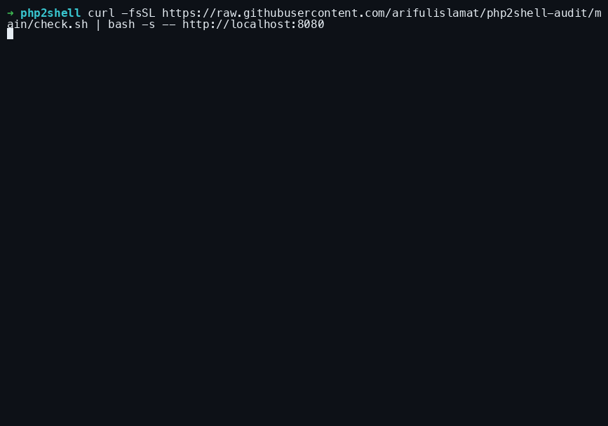

# php2shell checker

Find out if your PHP site is exposed to **php2shell**: CVE-2026-109618 and CVE-2026-109619, an unauthenticated remote code execution flaw in PHP itself.
It affects WordPress, Laravel, Drupal, Joomla and custom PHP alike. Fixed in **PHP 8.5.12, 8.4.27, 8.3.36 and 8.2.35**. PHP 8.1 and older get no upstream fix.



All three tools are **read-only**. They send no exploit payloads and change nothing.

Write-up: [php2shell: is your WordPress, Laravel or PHP site affected?](https://dev.to/arifulislamat/php2shell-is-your-wordpress-laravel-or-php-site-affected-how-to-patch-today-3jla)

## Quick start

**On your server.** This is the most accurate check:

```sh
curl -fsSL https://raw.githubusercontent.com/arifulislamat/php2shell/main/check.sh | sudo bash
```

**From your computer, against any site:**

```sh
curl -fsSL https://raw.githubusercontent.com/arifulislamat/php2shell/main/check.sh | bash -s -- https://example.com
```

**In the browser:** [arifulislamat.github.io/php2shell](https://arifulislamat.github.io/php2shell/)

Prefer to read the script before running it? Download it, then run it with `bash check.sh` or `bash check.sh https://example.com`.

## What it checks

### Server mode

**PHP runtimes:**
- Every PHP build: CLI, FPM, CGI, LiteSpeed, FrankenPHP, and cPanel / Plesk / Remi / CloudLinux builds
- Apache mod_php, the highest-risk setup
- Distro backports, via the Debian/Ubuntu/RHEL changelogs (the version number often stays old)
- Workers still running replaced code after an upgrade, meaning a restart is still needed
- The `session.upload_progress.enabled` mitigation
- Docker and Podman containers

**Signs of compromise since 2026-10-19:**
- Web-shell code, PHP in upload folders, recently changed PHP files, `auto_prepend_file` backdoors
- New WordPress admins (needs wp-cli)
- Shells running as the web user, web-user crontabs, outbound connections
- Worker crashes and memory errors in the logs, and bursts of POST requests answered with HTTP 500

### Remote mode

Fingerprints PHP from the outside:
- `X-Powered-By` header and session cookies
- WordPress, Laravel, Drupal and Joomla markers
- Exposed `phpinfo()` pages
- The hosting provider (see below)

If the version is hidden, or might be a distro backport, it says so instead of guessing.

### Exit codes

| code | meaning |
|---|---|
| `0` | nothing found |
| `1` | vulnerable PHP |
| `2` | possible compromise |
| `3` | site unreachable |
| `4` | PHP found, but its version can't be confirmed from outside |

### Options

- **Custom web roots:** `WEBROOTS="/srv/a /srv/b"` scans those folders.
- **No colours:** `NO_COLOR=1` turns off colours and animation. Both also switch off automatically when output isn't a terminal, so logs and CI get plain text.

## Managed hosts: `docs/providers.tsv`

Most managed hosts (WP Engine, Kinsta, SiteGround and others) hide the PHP version.
For those sites, the script and the page recognise the host from its response headers or temporary domain, then show that host's patch status from this file.
Edit it on GitHub and push: both read it live, so nothing needs redeploying.

| column | meaning |
|---|---|
| `header_regex` | ERE matched case-insensitively against each `name: value` response header line |
| `host_regex` | ERE matched against the hostname, e.g. `.wpengine.com` staging domains |
| `patched` | `yes`, `no` or `unknown` |
| `checked` | date the status was confirmed |
| `link` | the host's status page or advisory |
| `note` | shown to users |

Only set `patched=yes` once the host has said so publicly, and put that announcement in `link`. A visible PHP version always wins over this file.
The fingerprints were checked against live sites on 2026-10-22. Cloudways is matched by its temporary domain only.

## Web page

`docs/index.html` is served by GitHub Pages, and `worker/` is its backend.
Browsers can't read another site's headers, so a small Cloudflare Worker fetches them. Deploy it once, then point the page at it:

```sh
cd worker && npx wrangler deploy     # prints https://php2shell-check.<you>.workers.dev
```

1. Put that URL in the `API` constant in `docs/index.html`.
2. Enable GitHub Pages: Settings → Pages → Deploy from branch `main`, folder `/docs`.

## Local development

```sh
bash check.sh --selftest                        # version logic
bash check.sh http://localhost:8080             # remote mode against a local site
cd worker && npx wrangler dev                   # Worker on :8787
python3 -m http.server -d docs 8000             # page on :8000, which uses the local Worker automatically
```

A vulnerable test target: `docker run -d -p 8080:80 php:8.3.6-apache`.

## Responsible use

Scan sites you own or are responsible for. Remote mode only sends ordinary GET requests for a few public paths.
No outside check can prove a site is safe: when in doubt, run the server check or ask your host for the PHP version.

## License

[MIT](LICENSE) © Ariful Islam · [arifulislamat.com](https://arifulislamat.com)
